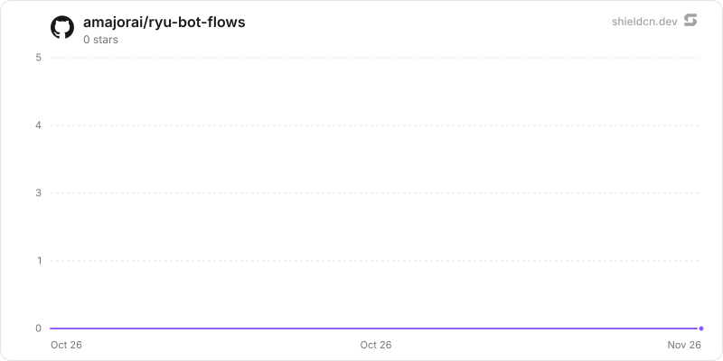

<div align="center">

# bot-flows

</div>

Build conversational bots from preconfigured flows for support, lead capture, surveys, and intake, then share or embed them from a Ryu node.

> **The public home of `ryu-bot-flows`.** Source, builds, and releases live here —
> binaries for every platform are attached to each release.
>
> This tree is generated from the Ryu monorepo, so commits pushed here
> directly are replaced on the next sync. **Pull requests are welcome** —
> open them here and they are ported into the monorepo, then flow back out.
> Ryu as a whole: https://github.com/amajorai/ryu

## Install

**App:** [Install](ryu://apps/com.ryu.bot-flows) (opens the Ryu desktop app and asks you to confirm)

**CLI:**

```bash
ryu apps add com.ryu.bot-flows
```

## Source & build

The **source of record** for this app: a Bun/TypeScript
`sidecar/` Ryu runs locally as a grant-gated control capability, plus the
manifest `ui/`. The sidecar builds standalone — `cd sidecar && bun install &&
bun run build` compiles a single `ryu-bot-flows` executable; each release attaches
the per-platform binaries.

## License

Apache-2.0 — see [LICENSE](./LICENSE).

## What it adds

- A **Bot Flows** companion and sidebar button for building flows, previewing
  drafts, managing knowledge articles, and reading results.
- The `ryu-bot-flows` local sidecar (`sidecar/`), which stores bots, published
  snapshots, conversations, and results on the node. Core reaches its admin API
  with the `app:http` grant; published bots are served publicly under `/bots`
  (`/bots/<slug>`, `/bots/<slug>/embed.js`).
- AI reply blocks call the node's model through Core (`hook:side-model`) with
  the owner's instructions only, within per-conversation and per-day budgets.
- `@ryu/bot-flows#conversation.completed` and `@ryu/bot-flows#handoff.requested`
  hook events, so a Workflow with an event trigger can open a ticket, add a CRM
  contact, or post a message. Preview runs never emit them.

## Sidecar

- `src/contracts.ts` is the shared Flow model and wire contract. The Companion
  imports it as `../../sidecar/src/contracts.ts` (or
  `@ryu/bot-flows-sidecar/contracts`); it depends only on `zod`.
- `src/engine.ts` runs conversations with injected model, HTTP, event, clock,
  and randomness dependencies; `src/templates.ts` holds the templates.
- `http_request` blocks go through `src/http-guard.ts` (https only, public
  addresses only, no redirects, 256 KiB responses).
- Request bodies are capped at `BOT_LIMITS.maxBodyBytes` (1 MiB), which is the
  manifest's `http.max_body_bytes`. Core's ext-proxy applies that one cap to
  every route of the sidecar, public and admin alike; the sidecar caps public
  bodies at `BOT_LIMITS.publicBodyBytes` (8 KiB) itself. The flow and knowledge
  contracts check the whole body against the cap, and the Companion can check a
  body first with `jsonBodyBytes` from `contracts.ts`.
- Result quotas (`resultsPerBot`, `resultsTotal`) count only conversations a
  visitor answered at least once. A public start that nobody answered is
  deleted once its 24-hour session ends, so empty starts cannot fill the quota.
  Owners can delete one result or all of a bot's results
  (`DELETE /admin/bots/:id/results[/:resultId]`).
- Per-visitor rate limits key on the right-most `X-Forwarded-For` hop when the
  request comes through Core over loopback. A request without a plain,
  non-loopback IP address there shares one `anonymous` bucket. Limitation: Core
  forwards `X-Forwarded-For` unchanged and does not add the real peer, so
  unless a proxy in front of Core overwrites the header, a caller can set its
  own key and rotate it. Per-visitor limits only spread capacity fairly. The
  real bounds are the per-bot start and reply limits, the daily AI budget, and
  the answered-results quota.
- Run `bun test` and `bunx tsc --noEmit` in `sidecar/`; `bun build.ts` compiles
  the `dist/ryu-bot-flows` binary.

## Companion UI

- `ui/` is the Companion (`@ryu/bot-flows-app`), built by `vite build` into the
  single-file `ui/dist/index.html` named by the manifest's `ui_entry`. Core
  embeds the copy that `scripts/sync-app-fixtures.sh bot-flows` vendors.
- It reaches the sidecar only through `window.ryu.app.request` and validates
  every response with the sidecar's contracts. `src/flow-model.ts` holds the
  pure flow-editing operations behind the canvas; `src/ai-generate.ts` is the
  "Generate flow" action (`window.ryu.model.complete`, applied only when the
  whole reply validates); the open bot is published to the global Ask Ryu
  assistant through `useAppAssistant` instead of an in-app chat pane.
- Run `bun run test`, `bun run check-types`, and `bun run build` in `ui/`.
  `bun run test:e2e` starts the sidecar and the Vite dev server with a test
  bridge and refreshes the screenshots in `ui/e2e/evidence/` (set
  `RYU_PLAYWRIGHT_CHROMIUM` to use an existing Chromium). That harness does not
  go through Core.

## Star History

<a href="https://github.com/amajorai/ryu-bot-flows/stargazers">
  <picture>
    <source media="(prefers-color-scheme: dark)" srcset="./.github/shieldcn/star-chart-dark.svg" />
    
  </picture>
</a>
